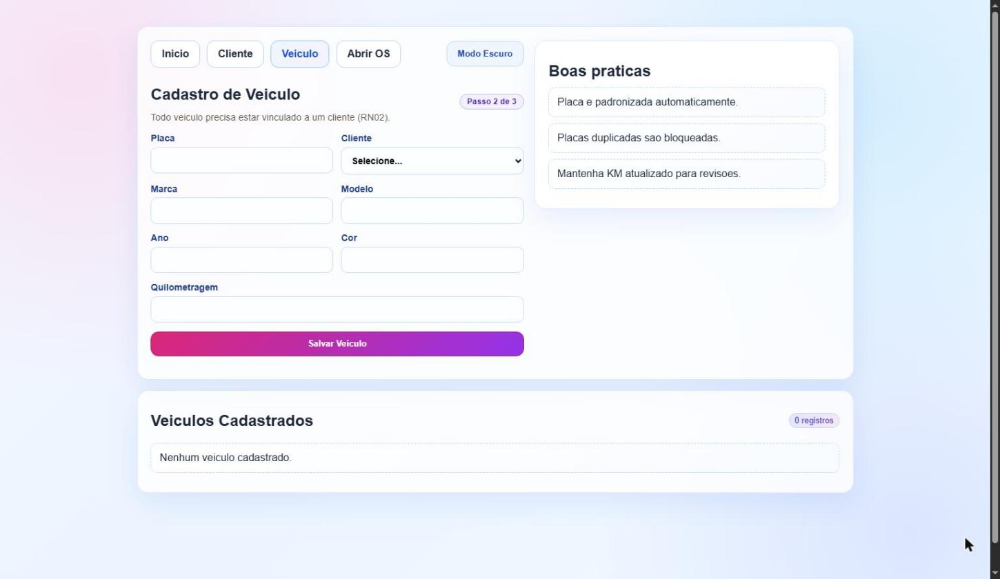

# AutoCheck Manager

Sistema de gestão para oficina mecânica com foco no começo do atendimento: cadastro do cliente, cadastro do veículo e abertura da ordem de serviço (OS).

**[Testar online](https://nycollef.github.io/auto-check-system/)**

## Status

Projeto em fase inicial (MVP).

- Frontend funcionando em HTML, CSS e JavaScript
- Dados salvos no navegador (`localStorage`)
- Pasta do backend criada, ainda sem código

## Problema que resolve

Na oficina muita coisa é anotada à mão. O AutoCheck ajuda a:

- Encontrar fácil o histórico de clientes, veículos e OS
- Organizar a entrada dos carros
- Seguir regras básicas sem depender da memória de quem atende

## Funcionalidades

- Cadastro de clientes
  - Bloqueia CPF repetido
- Cadastro de veículos
  - Todo veículo precisa ter um cliente (RN02)
  - Placa padronizada automaticamente
  - Bloqueia placa repetida
- Abertura de OS
  - Número automático no formato `OS-ANO-XXXXXX`
  - Filtra os veículos pelo cliente escolhido
  - Não deixa abrir duas OS para o mesmo veículo (RN01)
- Tema claro e escuro

## Regras de negócio

- RN01: não permite duas OS abertas para o mesmo veículo
- RN02: todo veículo precisa estar ligado a um cliente
- CPF e placa não podem se repetir

## Tecnologias

- HTML5
- CSS3
- JavaScript
- `localStorage`

## Como rodar

Não precisa instalar nada.

1. Clone o repositório: `git clone https://github.com/NycolleF/auto-check-system.git`
2. Abra o arquivo `frontend/index.html` no navegador

## Documentação

- Requisitos e regras: `docs/requisitos/documento-projeto.md`
- Modelo do banco de dados: `docs/requisitos/modelo-banco.sql` (tabelas de clientes, veículos, OS, diagnóstico, agenda e histórico)
